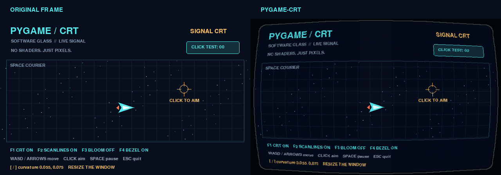

# pygame-crt

**A CRT screen for your Pygame game.** Curved glass, scanlines, a subtle phosphor
texture, edge shading, optional bloom, and a monitor bezel. Runs on regular
Pygame surfaces with no OpenGL context, shaders, NumPy, or external art assets.



Originally developed for **OVERDRILL**, now extracted into an independent Python
package. Supports both **pygame-ce** and **Pygame** with the same API.

## Install

Requires Python 3.10+. Version 0.1.0 is distributed on GitHub; it has **not** been
published to PyPI. Choose **one** backend in a virtual environment:

```sh
# Recommended for a new project: pygame-ce
python -m pip install "pygame-crt[ce] @ git+https://github.com/mmtdgn/pygame-crt.git@v0.1.0"

# Alternatively, use classic Pygame
python -m pip install "pygame-crt[pygame] @ git+https://github.com/mmtdgn/pygame-crt.git@v0.1.0"
```

If your environment already has Pygame or pygame-ce, install without an extra:

```sh
python -m pip install "git+https://github.com/mmtdgn/pygame-crt.git@v0.1.0"
```

Both distributions provide the `pygame` import. Do not install both in the same
environment. The base package deliberately does not force either distribution.
Git is needed for the commands above. Without Git, download and extract the
source ZIP from [Releases](https://github.com/mmtdgn/pygame-crt/releases), then run
`python -m pip install ".[ce]"` inside the extracted folder. A wheel is also
provided with each release.

## Try the demo

```sh
python -m pygame_crt.demo
# Or: pygame-crt-demo
```

The demo draws an animated starfield and ship entirely with Pygame primitives.
Resize the window, move the ship, click the target area, and test the button
near the curved edge.

| Control | Action |
| --- | --- |
| F1 | Toggle the entire CRT effect |
| F2 | Toggle scanlines |
| F3 | Toggle bloom |
| F4 | Toggle the monitor bezel |
| `[` / `]` | Decrease / increase curvature |
| WASD / arrow keys | Move the ship |
| Left click | Place a target or activate the click-test button |
| Space | Pause animation |
| Escape | Quit |

## Add it to a game

Create one filter, draw a **fresh, complete frame**, then apply the filter just
before presenting it. The filter never creates a window, polls events, or flips
the display.

```python
import pygame
from pygame_crt import CRTFilter

pygame.init()
screen = pygame.display.set_mode((800, 600))
clock = pygame.time.Clock()
crt = CRTFilter()
running = True

while running:
    for event in pygame.event.get():
        if event.type == pygame.QUIT:
            running = False

    screen.fill((12, 18, 32))
    pygame.draw.circle(screen, (80, 240, 220), (400, 300), 80)
    # Draw your world and UI here.
    crt.apply(screen)  # In place; returns the same Surface.
    pygame.display.flip()
    clock.tick(60)

pygame.quit()
```

See [examples/minimal.py](examples/minimal.py) for a moving, resizable example.
Do not repeatedly filter the previous output: shading and resampling would
accumulate. Draw any overlays you want to remain flat **after** `apply()`.

## Scaling, a bezel, and mouse input

For a game rendered to its own logical surface, use `render()`. It preserves the
source aspect ratio, letterboxes, reserves room for the bezel, and leaves the
source unchanged. No 16:9 resolution is assumed.

```python
game = pygame.Surface((640, 400))
crt = CRTFilter(bezel=True, bloom=True)

# Inside your event loop, before handling mouse input:
viewport = crt.viewport(game.get_size(), screen.get_rect())
for event in pygame.event.get():
    if event.type == pygame.MOUSEBUTTONDOWN:
        position = crt.map_to_source(event.pos, game.get_size(), viewport)
        if position is not None:
            # Test game-space buttons / aim using position.
            print(position)

# Draw a fresh world and UI onto game, then:
viewport = crt.render(game, screen)
pygame.display.flip()
```

`map_to_source()` accounts for scaling, letterboxing, curved glass, and rounded
bezel corners. It returns `None` outside the visible picture. Recompute the
viewport after resizing or toggling the CRT/bezel. Use the event's `pos` for
clicks, and `pygame.mouse.get_pos()` for hover.

When using `apply()` directly, pass the surface's rect and `bezel=False`:

```python
position = crt.map_to_source(
    pygame.mouse.get_pos(), screen.get_size(), screen.get_rect(), bezel=False
)
```

`display_point(point, size)` and `source_point(point, size)` expose the continuous
forward/inverse mapping in local pixels. Actual rendering rounds strips to
integer pixels; small click tolerances are appropriate for tiny targets.

## Settings

All settings are constructor keyword arguments and can be changed atomically:

```python
crt = CRTFilter(curvature_x=0.04, curvature_y=0.06, bloom=True)
crt.configure(scanline_alpha=32, vignette=False)
crt.enabled = False  # apply() becomes an exact no-op; render() still aspect-fits.
```

| Setting | Default | Meaning |
| --- | --- | --- |
| `curvature_x`, `curvature_y` | `0.055`, `0.075` | Horizontal / vertical compression, each 0–0.5; 0 disables that axis |
| `scanlines` | `True` | Horizontal dark lines |
| `scanline_alpha` | `20` | Opacity, 0–255 |
| `scanline_spacing` | `0` | Pitch in pixels; 0 adapts to output height (minimum 3) |
| `phosphor` | `True` | Subtle vertical blue-green texture |
| `phosphor_alpha` | `9` | Texture opacity, 0–255 |
| `vignette` | `True` | Soft edge shading |
| `vignette_alpha` | `30` | Maximum edge opacity, 0–255 |
| `bloom` | `False` | Low-resolution highlight glow |
| `bloom_threshold` | `100` | Per-channel subtraction before blurring, 0–255 |
| `bloom_strength` | `0.22` | Highlight multiplier, 0–1 |
| `bezel` | `True` | Monitor rim; used only by `render()` |
| `bezel_ratio` | `1/60` | Border margin / shorter destination side, 0–0.2 |
| `background` | `(2, 5, 8)` | RGB outside the glass and under transparent input |

`CRTConfig` is a frozen dataclass, also accepted as `CRTFilter(CRTConfig(...))`.
Read settings through `crt.config`; update them with `configure()` so caches are
invalidated. `clear_cache()` releases cached surfaces. Each filter keeps only
its current frame size; use separate instances for differently sized views.

`render(source, target, rect=None)` optionally draws inside a destination rect,
which must fit completely within the target. It returns the inner viewport and
leaves pixels outside that destination rect alone. Source and target should be
separate surfaces if you need to preserve the source.

## Performance and limits

- This is a **CPU/software** effect, not a GPU shader. Cost rises with output
  resolution and curvature. 4K/60 FPS is not guaranteed.
- Work surfaces, strip mappings, textures, and the bezel are cached. The first
  frame after a size/settings change includes setup cost.
- For best performance, filter a smaller logical surface with `apply()`, then
  scale it to the window yourself. `render()` filters at the destination viewport
  resolution, keeping UI and scanlines finer but costing more.
- Uses 24-bit or 32-bit software surfaces. Indexed/16-bit surfaces, locked
  surfaces, and direct `pygame.OPENGL` framebuffers are not supported.
- Input should be a completed opaque frame. Alpha input is flattened onto the
  configured background while the filter is enabled; alpha is not preserved.
  `apply()` clears the surface's alpha-blending and colorkey settings afterward.
- Render with a full-surface clip rectangle. The filter does not manage dirty
  rectangles, sprite hitboxes, custom OS cursors, or application event loops.
- Rescaling the picture changes individual pixel values. Keep text readable and
  provide players with an off switch.

Measure on your own machine (includes scaling, CRT, and bezel; excludes flip):

```sh
python -m pygame_crt.demo --headless --benchmark
```

## Development

```sh
git clone https://github.com/mmtdgn/pygame-crt.git
cd pygame-crt
python -m venv .venv
# Activate .venv for your shell, then:
python -m pip install -e ".[ce,dev]"
python -m unittest discover -s tests -v
python -m ruff check .
python -m ruff format --check .
python -m pygame_crt.demo --headless --frames 5
python -m build
python -m twine check dist/*
```

Use a separate environment with `.[pygame,dev]` for classic Pygame. CI checks
both backends on Windows, Linux, and macOS with Python 3.10 and 3.13, plus builds
and installs the release wheel. Local validation details are in
[docs/validation.md](docs/validation.md).

Generate the README illustration from the same code shipped in the package:

```sh
python -m pygame_crt.demo --headless --comparison docs/comparison.png
```

## License and origin

[MIT](LICENSE), copyright 2026 mmtdgn. Adapted from the author's CRT renderer for
OVERDRILL. This repository contains only the reusable filter, its procedural
demo, documentation, and tests; it does not include OVERDRILL's game assets.
Pygame and pygame-ce retain their own licenses and are installed separately.
